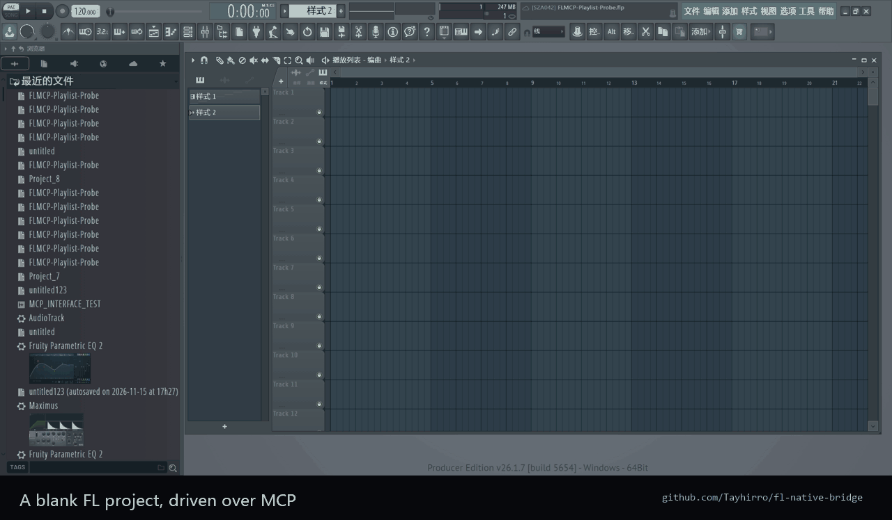

<p align="center"></p>

<p align="center">
  <a href="README.md">English</a> · <strong>中文</strong>
</p>

# fl-native-bridge

一个运行在 FL Studio 自带 Python 进程内的原生 C 扩展，直接调用引擎内部例程——并以 MCP 工具的形式暴露给 AI 助手。

大多数 FL Studio 的 MCP 服务都是封装公开的 controller API。那套 API 是真的，但它的边界就是 FL 自己 UI 的边界：你能移动一个 clip，却没法替换插件的内部状态。本项目把编译好的扩展加载进 FL，在更低一层工作——这正是「带完整状态克隆效果器」这类操作成为可能的原因。



*截自真实的 FL Studio 26.1.7.5654 会话——窗口是正在运行的应用程序，完全由工具调用驱动，字幕轨标注每一步。*

## 公开 API 做不到、而本桥可以的事

| 操作 | 公开 API | 本桥 |
| --- | --- | --- |
| 读取插件的完整状态 | 只有参数名/值 | 原始状态记录（事件 213），带哈希——实测小型 FL 效果器 8 字节、Fruity Delay 3 为 108 字节、某 VST3 为 222 字节 |
| 带完整状态克隆效果器 | 不可能 | 用捕获到的记录重建插件的出厂 FST 骨架，加载后比对 SHA-256 |
| 交换两个 FX 槽位 | 不可能 | 两个插件连同完整状态一起搬移；有从捕获记录恢复的补偿路径 |
| 按名称加载预设 | 只有 `nextPreset`/`prevPreset`，且没有读取当前预设名的 getter | 解析 Plugin Database 里的 `.fst` 并加载 |
| 切换当前 Arrangement | 未暴露 | `fl_set_current_arrangement`，带读回确认 |
| 往*当前* Arrangement 插入 clip | 不支持 | 按活跃 Arrangement 插入（此前硬编码索引 0 的 bug 会在 2 个以上 Arrangement 时出错） |
| 非线性自动化 | 曲线 dword 存了，但这个 build 上派生缓存始终为零 | 密集线性点整形（`ease_in`/`out`/`in_out`/`exponential`） |

上表每条都在独立的 FL 实例里实测过，不是推断。细节见 `SEMANTIC_NATIVE.md`、`NATIVE_BRIDGE.md` 和[验证记录](evidence/README.md)。

## 环境要求

| | |
| --- | --- |
| FL Studio | **26.1.7.5654**，Windows x64——偏移量按这个 build 校准 |
| Python | FL 自带的 3.12 运行时（`Shared/Python`） |
| MIDI 端口 | **不需要**——桥走的是文件队列 RPC，不需要 loopMIDI 或 IAC Driver |
| 构建工具 | 不需要，除非你要重编译（那就需要 MinGW-w64 的 `gcc`/`dlltool` + CPython 3.12 头文件） |

检测到引擎 profile 不匹配时，扩展会拒绝加载——错误的 FL 版本会 fail closed，而不是往错误地址写东西。每个原生操作都带一条依赖记录，声明它的那张表同时也生成对外公布的操作目录。每条记录分别给出函数入口、全局地址、对象布局和调用约定的证据等级，并在 handler 执行前检查；`fl_list_capabilities()` 把同一张表报在 `native.dependencies` 下。`evidence: independent` 表示该入口在本 build 上被单独观测过，并且会把记录的字节签名与实时镜像比对；`build-gated` 表示只有精确 SHA-256 和 handler 内的检查。动态解析的 vtable 入口、以及没有记录字节签名的入口，一律标为 `build-gated`——不夸大。依赖未验证的操作会在碰 FL 内存之前就被拒绝。

## 安装

1. 把 controller 文件拷进 FL 的 Hardware 目录：

```
%USERPROFILE%\Documents\Image-Line\FL Studio\Settings\Hardware\FLStudioMCP\
    device_FLStudioMCP.py
    semantic_native.py
    bridge_extension.py
    native_rpc.py
    _flmcp_native.pyd
```

2. 安装 MCP server：

```bash
uv sync          # 或者：pip install -e .
```

3. 在你的 MCP 客户端（Claude Desktop / Claude Code）里注册 server：命令 `fl-native-bridge`，或 `python -m fl_studio_mcp.server`。

4. 在 FL Studio 里：**Options → MIDI settings → Controller type → FLStudioMCP**，然后启用端口。controller 会发布心跳，MCP server 自动连上正在运行的实例。

## 安全与限制

- **本桥会写 FL 的内存。** 错误的调用可能损坏工程或让 FL 崩溃。做结构性编辑前先存副本——`fl_save_project_copy` 就是干这个的；破坏性工具会明确报告它无法验证的部分。
- **版本锁定。** FL 一更新，偏移量就会变。加载受引擎 profile 字符串门禁控制；不支持的 build 会被拒绝，而不是靠猜。
- **不是所有操作都能撤销。** 在这个 build 上，移除效果器和替换预设不会注册可恢复的 Undo。不能撤销的工具会在结果里明说（`irreversible: true`），不装作可以。
- **不分发任何 FL 二进制文件。** 本仓库只包含本项目的 C 源码、Python 代码和偏移常量。FL Studio、它的 DLL 和出厂内容都不包含在内。

## 架构

```
MCP 客户端（Claude 等）
        │  MCP 工具调用
        ▼
src/fl_studio_mcp/                    Python MCP server、schema、校验
        │  文件队列 RPC（native_rpc/<pid>/）
        ▼
fl_controller/device_FLStudioMCP.py   运行在 FL 的 Python 里
        │  扩展调用
        ▼
_flmcp_native.pyd                     由 fl_controller/native/*.c 编译
        │  直接调用 / 读 / 写
        ▼
FLEngine_x64.dll                      引擎内部
```

MCP server 从不直接碰 FL。每一次变更都带着请求 ID 和超时跨过文件队列，在 FL 的 idle 线程上执行，并在工具报告成功之前读回确认。

## 工具面

173 个 MCP 工具，覆盖走带、Mixer、通道、Pattern、钢琴卷帘、Playlist、Arrangement、插件和工程存副本。原生层暴露 35 个操作：

| 模块 | 操作数 | 例子 |
| --- | --- | --- |
| automation | 9 | 点读取/写入/移动、source 和 link 创建、vtable dump |
| playlist | 7 | clip 插入/删除/复制/静音、裁剪、source 窗口 |
| arrangement | 6 | 读取/新增/克隆/删除/重命名/切换 |
| timeline | 4 | 标记 |
| pattern | 3 | 音符读取/新增/写入 |
| channel | 3 | Sampler 插入、采样替换 |
| mixer | 2 | 效果器加载/移除、槽位状态 |
| project | 1 | 存副本 |

## 测试

```bash
uv run pytest -q        # 100+ 项测试，不需要 FL（RPC 层是 mock 的）
```

原生层用独立的端到端脚本在真实 FL 实例上验证：脚本启动 FL、打开一次性工程、驱动操作、再读回状态。

## 致谢

基于 [karl-andres/fl-studio-mcp](https://github.com/karl-andres/fl-studio-mcp)（MIT）构建——controller 框架、MCP server 结构和工具约定来自该项目，原作者为 calvinw 和 Karl Andres。原生扩展、语义层和本文记录的引擎级操作是本项目的工作。

## 许可

MIT——见 [LICENSE](LICENSE)。原始版权声明予以保留。
